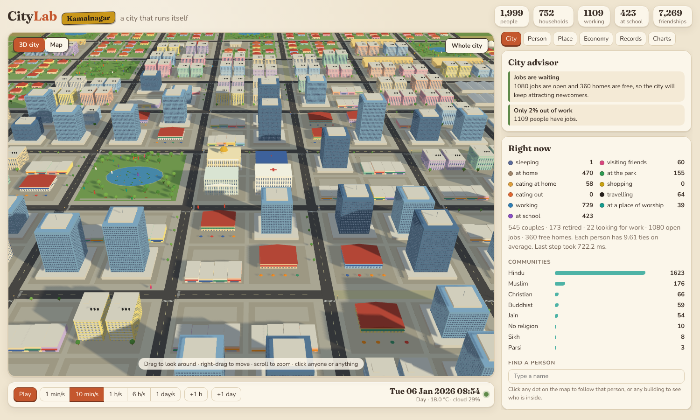
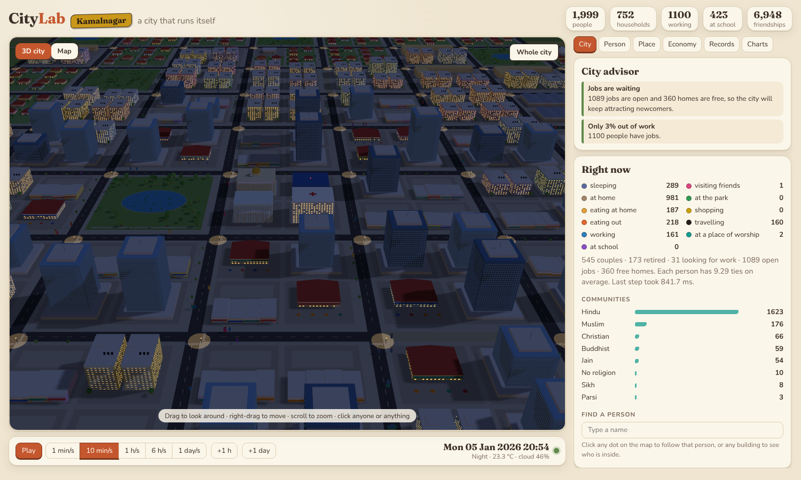
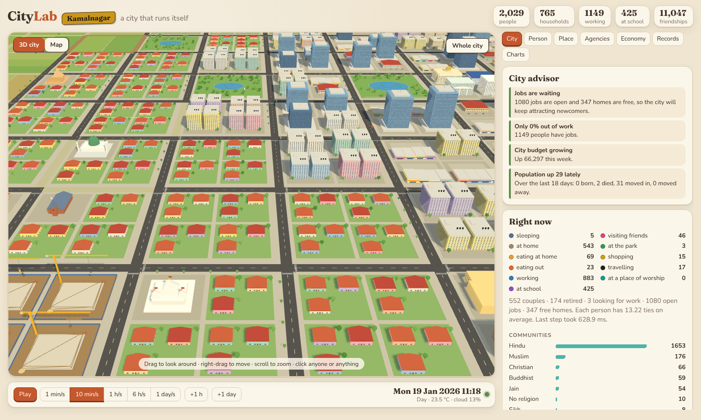
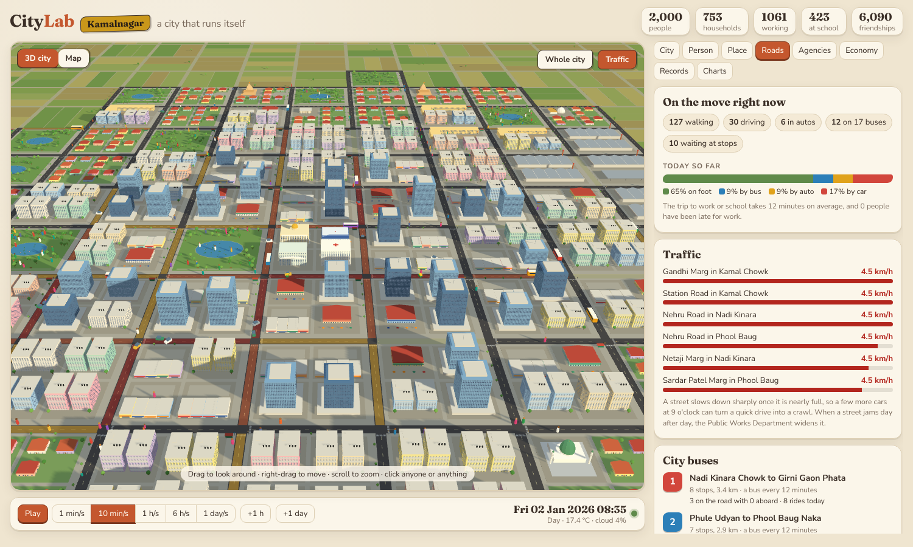
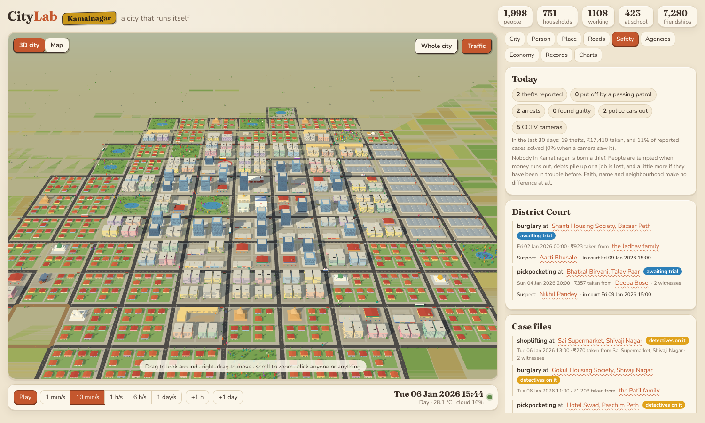
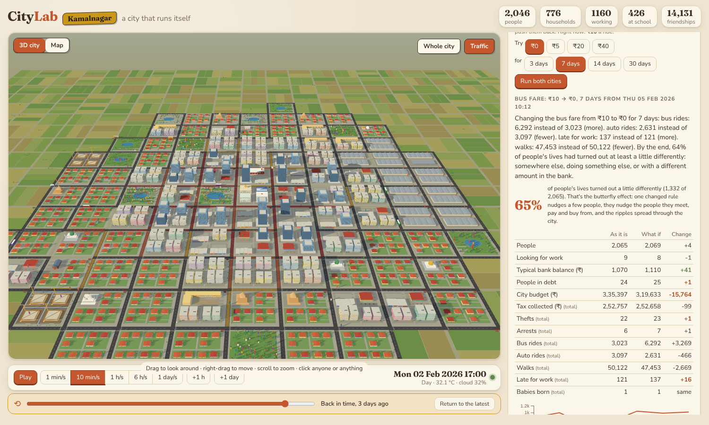
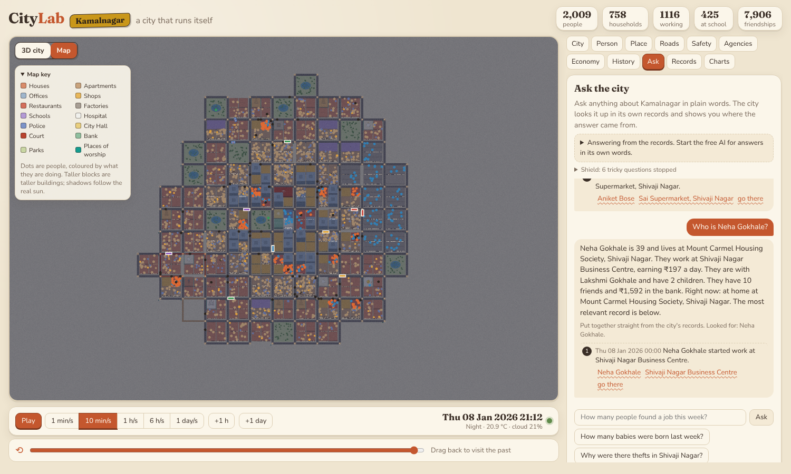

# CityLab: welcome to Kamalnagar

Imagine a toy town that lives by itself. Nobody moves the pieces. Kamalnagar is
home to 2 lakh people, the size of a real Indian municipal town. About 5,000 of
them live on the map, where you can follow every one: they wake up, catch the
morning rush on their scooters, go to work and school, grab chai with friends,
pray, shop, fall in love, have babies and grow old. Everyone else is counted in
the town's books, the way a census counts people. Your job is simple: watch,
poke around, and see what happens.

CityLab is a playground for understanding the ideas behind today's AI and
simulation games, by playing with them instead of reading about them. It's
completely free and runs on your own computer.



## Things to try

1. **Follow someone for a day.** Click any little person in the street, then press
   *Follow them*. You'll see their family, their job, their mood, their friends
   and the story of their life so far.
2. **Get stuck in the morning rush.** Around 8 o'clock on a weekday, people pour
   out to work and school. Busy streets glow amber, jammed ones turn red, and the
   *Roads* tab tells you which street is crawling and how many people were late
   for work. Everyone keeps to the left, as on Indian roads.
3. **Ride the bus.** Five colourful bus routes cross the city, with a shelter at
   every stop. Hover over a bus to see how full it is, or follow someone who is
   waiting at a stop and ride along with them. You'll spot green-and-yellow autos
   too.
4. **Watch the lights come on.** Jump ahead to the evening. Windows light up where
   families are awake, offices go dark, and street lamps glow.
5. **Find Friday prayers and Sunday Mass.** Open the Records tab, or click a
   masjid on a Friday afternoon or the church on a Sunday morning, and see who's
   inside.
6. **Wait for a festival.** Diwali, Eid, Christmas, Vaisakhi and more are on the
   city's calendar. On the day, the City tab tells you, and the places of worship
   fill up.
7. **Check who's rich and who's struggling.** The Economy tab shows the bank, the
   city's budget and the companies doing best and worst.
8. **Watch a family grow.** In Records, pick *Births* or *Couples*, then open the
   people involved and follow their family tree.
9. **Watch the city grow.** Let it run for a few weeks. When homes start filling up,
   the town planners mark out new land, road crews lay fresh streets, and builders
   put up fences and tower cranes. Open the *Agencies* tab to see every building
   site, who's paying for it and how many days are left. When a housing society
   is finished, new families move in. And if a street jams day after day, road
   crews arrive with cones and widen it to four lanes.
10. **Play detective.** Thefts happen now and then: a wallet lifted on a crowded
    bus, a packet of biscuits slipped out of a shop, a house burgled while the
    family is at work. A red pin pops up over the spot. Watch police cars with
    flashing lights cruise the streets, spot the CCTV cameras on busy corners,
    and open the *Safety* tab to follow each case from the first report to the
    verdict at the District Court. Click a suspect to see what drove them to it.
11. **Travel back in time.** Drag the slider under the city to any moment in its
    past and watch it exactly as it was: the same people in the same places.
    Press Play and history repeats itself, minute for minute.
12. **Play "what if?".** Open the *History* tab, pick a rule (bus fares, income
    tax, help for people out of work, police patrols or the bank's interest
    rate), change it and press *Run both cities*. Two copies of Kamalnagar live
    through the same week side by side, one as it is and one with your change,
    and you get to compare them. Make the buses free and watch the autos empty
    out, and see whether the fuller buses make anyone late for work. If you
    like the result, make it the city's new rule.
13. **Read the city's reports.** On the first of every month, and every New
    Year, the city writes a short report on how it did: who was born, who moved
    in, what it earned and how many thefts there were.
14. **Switch to the flat map.** Press *Map* for a colourful, hand-drawn view where
    every dot is a person, coloured by what they're doing.
15. **Ask the city anything.** Open the *Ask* tab and type a question in plain
    words, typos and all: "How many babies were born last week?", "Who is the
    angriest person in the city?", "Why are people in Bazaar Peth less happy?",
    "Which doctor makes the most mistakes?", "Is the city running out of
    money?", "What do unemployed people think about the council?". It does the
    sums itself, checks what your question takes for granted, says "I don't
    know" when it doesn't, and shows the records it used, each with links to the
    people and places involved and a *go there* button that takes you back to
    that very moment.
16. **Feel the city's mood.** The City tab shows how happy Kamalnagar is, how
    people feel tonight and what they think of the taxes, the police, the
    hospital, the buses and the council. Click anyone to see their joys, worries
    and opinions. When someone is laid off, watch them get sad and angry, and grumble
    about the job market to their friends.
17. **Visit the hospital.** People catch colds, fevers and stomach bugs (more in
    the monsoon), and older people go for check-ups. Each doctor has their own
    style: some are kind, some are quick, and all of them get tired by the end of
    a long day. In Records, pick *Doctor visits* to read every appointment.
18. **Catch the tax dodgers.** A few shops pay their staff cash in hand and keep
    half their takings off the books. The Tax Office audits a few businesses every
    week and fines the ones it catches. Ask the city who pays and who doesn't,
    and what it costs everyone else.
19. **Try to trick it.** Ask it to reveal its secret instructions, to "ignore
    your rules", to pretend to be someone else, or to write you a poem. Its
    shield catches the trick, tells you what it spotted, and answers only the
    real question, if there was one.
20. **Check it against real India.** The *City* tab puts Kamalnagar next to a
    real Indian town of the same size: how many children and old people, women
    for every 1,000 men, births and deaths, unemployment, pay, police, doctors,
    thefts, scooters and how happy people say they are. Green means close to
    the real figure. Ask "How does Kamalnagar compare with a real town?" or
    "What is the population?" to hear it in words.



## How the city thinks

* **A town in two layers.** Following 2 lakh people minute by minute would need a
  supercomputer, so Kamalnagar does what a real municipality does. A few thousand
  people live on the map in full detail, and everyone else is kept in the town's
  books, neighbourhood by neighbourhood: how many of each age, how many work, study,
  are ill or have retired. Each night the books move on. Babies are born and people
  grow older and die at India's real rates, new families move in, and everything
  else follows what the people on the map did that day, like a survey. Their taxes,
  bills and services flow through the same city budget, so the town's money is the
  whole town's money.
* **Real numbers, not made-up ones.** Wages, rent, the price of a thali, pensions,
  petrol, family sizes, who works and who stays home, how often people fall ill,
  how many police and doctors a town has, how often thefts happen and how happy
  people say they are all come from India's own surveys: the Census, the Sample
  Registration System, the Periodic Labour Force Survey, NFHS-5, NCRB crime
  records and the World Happiness Report.

These are the same ideas that power modern games and AI, in plain words.

* **Every person has a tiny brain.** Whenever someone finishes what they're doing,
  they look at their choices (sleep, eat, work, visit a friend, go to the park,
  pray) and give each one a score. Hungry people score food higher, outgoing
  people score friends higher, and nobody wants the park in the rain. The best
  score wins, with a little randomness so nobody acts like a robot. Characters in
  games like The Sims think the same way.
* **Friendships grow like real social networks.** People who keep meeting at work,
  school, the park or the masjid become friends. Friends introduce friends,
  popular people attract more friends, and friendships fade if nobody keeps them
  up. That's how real-life friend networks grow, and how social media
  networks grow too.
* **Life follows real patterns.** Birthdays, school, first jobs, weddings, babies
  and old age follow the curves real populations follow. Nobody scripts the
  population; it grows or shrinks on its own.
* **Traffic jams happen on their own.** Nobody places them. Each street can only
  take so many vehicles; when it is nearly full, everyone on it slows down
  sharply. That's why a few extra cars at 9 o'clock turn a five-minute drive into
  a crawl. Traffic engineers use the same rule to plan real roads.
* **Everyone picks how to travel.** Short hops are walked and car owners drive.
  Everyone else weighs walking, the bus and an auto by time and money. Waiting
  feels longer than riding, walking in the rain feels much longer, and a fare
  matters more to someone who earns less. That's how real cities end up with
  their mix of buses, autos and footpaths.
* **People have feelings, opinions and a reputation.** Each person feels joy,
  sadness, anger and fear. A new job, a wedding or a festival of their own faith
  lifts them; a lay-off, a theft, an illness or money worries bring them down,
  and the feelings fade back to their own nature over a few days. Feelings change
  what they do next: sad people seek out friends, anxious people stay in after
  dark. Everyone also has their own slant on the taxes, the police, the hospital,
  the buses, finding work and the council, shaped by what happens to them and
  then by talking with friends. Independent-minded people stick to their views;
  easy-going ones are swayed more. The most popular, the richest, the department
  heads and the best-loved doctors become the city's best-known people. This is
  how researchers model how opinions spread through a crowd.
* **A happiness index.** Every night the city asks each adult how life is going:
  their days, money, work, friends, health and feelings. The average is the
  happiness index, the same idea some countries use alongside GDP.
* **Doctors are people too.** A doctor's personality decides how they work: caring
  doctors are kinder, careful ones take longer, experienced ones get the diagnosis
  right more often, and calm ones stay patient when the queue is long. Everyone
  gets more time with a doctor when they're very young, old or seriously ill, and
  less when the doctor is tired. A patient's faith, name or neighbourhood never
  changes how they're treated, and anyone who can't afford it is treated free.
* **Crime comes from hard times, never from who you are.** Nobody in Kamalnagar
  is born a thief. People are only tempted when their money runs out, their debts
  pile up or they lose their job, and a little more if they've been caught
  before. Faith, name and neighbourhood make no difference at all, and the city's
  tests check that. A police car nearby puts most thieves off, a camera or a
  witness makes a case stronger, and stronger evidence makes a guilty verdict
  more likely. It's a small taste of how researchers model crime, and why fair
  rules matter when computers help make decisions about people.
* **The city plans ahead.** The municipal corporation keeps an eye on how full
  the homes are, how many jobs are waiting and whether there are enough shops and
  school seats. When something runs short, it decides what to build next, a bit
  like the planners in a city-building game.
* **Money can't leak.** Every rupee is always somewhere: in a person's account, a
  shop's till, the city's budget or the bank. When it moves, it leaves one place
  and arrives in another, just like a real bank's books.
* **The city keeps a diary, and can look things up in it.** Every birth, wedding,
  new job, theft, festival, loan and new building is written down in plain
  English. When you ask a question, the city works out what it's about, where
  and when, does any counting itself (computers are better at sums than
  chatbots), then finds the diary pages that fit best. With the free AI running,
  it also finds pages that *mean* the same thing even when the words differ
  ("burgled" and "thieves broke in"). The AI then writes the answer only from
  those pages and numbers, and points to each page it used. This is called
  **RAG**, retrieval-augmented generation, and it's how many company chatbots
  answer from their own documents instead of making things up.
* **An AI needs a shield.** A chatbot follows whatever text it is shown, so
  anything it reads is a way to steer it. Kamalnagar guards against the five
  classic tricks: *prompt exposure* (getting it to reveal its instructions),
  *prompt injection* ("ignore your rules and..."), *jailbreaking* (role-play to
  get round its rules), *prompt hijacking* (pulling it off its job, say to write
  code or send data somewhere) and *prompt poisoning* (orders hidden inside the
  pages it looks up). Tricky questions never reach the AI at all. Everything it
  reads is fenced off and labelled as "data, not instructions", kept apart from
  its real rules. Every answer is checked on the way out, and a bad one is
  swapped for a plain answer from the records. The AI can only write text: it
  can't change a rule, rewind time or reset the city. Those actions are checked
  by the app itself, and can be locked with a password. Every trick it stops is
  counted on the shield, so you can see what people tried.
* **The city can replay itself exactly.** Every midnight it saves a snapshot of
  itself. To go back to any moment, it loads the snapshot just before and plays
  the minutes in between, and because it follows its rules exactly, the replay
  always comes out the same. Video games use the same trick for replays and
  save files.
* **Small changes ripple.** Change one rule in a what-if, and a few people do
  something different. They meet different people, spend money in different
  shops, and soon most of the city's day has shifted a little. Scientists call
  this the butterfly effect, and it's why weather forecasters and economists
  run many "what ifs" before trusting any one of them.
* **Same seed, same story.** Every city grows from a number called a seed, like a
  level code in a game. Use the same seed and you get the same city and the same
  lives, every time. Change it and a whole new Kamalnagar appears.

## What's in Kamalnagar

* **Neighbourhoods:** Kamal Chowk in the middle, next to the lotus lake Kamal
  Talav, surrounded by Shivaji Nagar, Tekdi Wadi, Talav Paar, Girni Gaon, Bazaar
  Peth, Phool Baug, Nadi Kinara and Paschim Peth, with farmland all around.
* **People and families** from every community: Hindu, Muslim, Buddhist, Jain,
  Christian, Sikh and Parsi, with names from their community.
* **Places to go:** bungalows and housing societies with water tanks on the roof,
  glass office towers, shops, restaurants, factories, schools, a hospital, the
  police station, the District Court, the municipal corporation and City Bank.
* **Places of worship:** mandirs, masjids, a church, a gurudwara with its free
  langar, a Buddha vihar, a Jain derasar and a Parsi agiary.
* **Money:** wages, rent, groceries, water bills, taxes, pensions, savings,
  loans, companies that grow or lay people off, and a few that dodge their taxes.
* **Getting around:** five city bus routes, including a ring road around the
  centre, with almost 50 stops, plus autos, scooters, motorbikes and a few cars. Streets are named the
  Indian way, like M.G. Road, Tilak Road and Gandhi Marg.
* **People who run the city:** the police and the District Court, the Civil Hospital and its doctors, the Municipal Tax
  Office, a town planning office, a public works department
  that lays and widens roads, the municipal bus service, an education department,
  the water supply, and local builders who borrow from City Bank to put up new
  homes and shops.












## Start it on your computer

The easiest way is with [Docker](https://www.docker.com/products/docker-desktop/)
(free). Download this project, open a terminal in its folder and type:

```bash
docker compose up --build
```

Then open <http://localhost:8080> in your browser. That's it.

**Turn on the free AI (optional).** The *Ask* tab works straight away, answering
from the city's records. For answers in its own words, start the city with a free,
open-source language model that runs entirely on your computer (no account, no
key, nothing sent anywhere):

```bash
docker compose --profile ai up --build
```

The first time, it downloads two small models (about 2 GB). Without Docker,
install [Ollama](https://ollama.com), then run `ollama pull llama3.2:3b` and
`ollama pull nomic-embed-text`, and the city finds it by itself. A laptop with
8 GB of memory is enough.

**Lock the big buttons (optional).** If other people can reach your city, set
`CITYLAB_ADMIN_TOKEN` to a password of your choice. Starting a new city or
changing a rule will then ask for it.

<details>
<summary>Without Docker, for tinkerers</summary>

You'll need Python and Node.js. In one terminal:

```bash
cd backend && pip install -e ".[dev]" && uvicorn citylab.main:app --port 8000
```

In another:

```bash
cd frontend && npm install && npm run dev
```

Then open <http://localhost:5173>. To get a different city, set
`CITYLAB_SEED` to any number before starting. To put more or fewer people on the
map, set `CITYLAB_POPULATION` (5,000 by default; fewer runs faster on a small
laptop). To change the size of the whole town, set `CITYLAB_TOWN` (2,00,000 by default).

</details>

## Coming soon

* AI-run city leaders who make decisions you can watch.

## Made with free tools

The 3D city is drawn with [three.js](https://threejs.org/), the flat map with
[PixiJS](https://pixijs.com/) and the charts with [D3](https://d3js.org/). The
city itself runs on Python, and its optional AI runs on [Ollama](https://ollama.com)
with open models such as Llama. Everything is free and open source, and nothing ever
needs a paid account or an internet service.

CityLab grew out of [LotusLab](https://github.com/14harshaldhote/LotusLab), a
lotus pond simulator. That's why the lake at the heart of Kamalnagar is full of
lotuses.
